# Flows

Every screen in the customer app, the dashboard app, the public web and the admin web, and how they connect. Agreed on 2026-10-30. The same map, laid out visually, is the FigJam board [Hagz — Flows](https://www.figma.com/board/MHlgVOnTh7VsJ9ujpW1auG). The visual references are on [Hagz — UI direction](https://www.figma.com/board/01tdfBef6r79PAwN4EkQ4J).

Flow ids (`C6`, `D11`, `A7b`) match the board. Each diagram uses the same colors as the board:

| Color | Meaning |
|---|---|
| White | Screen |
| Blue | Bottom sheet or modal |
| Yellow | Choice or state |
| Green | Result |
| Red | Destructive action, or a blocked or failed state |
| Violet | Tab or hub |

## Decisions

- **Language and theme:** screens are designed in English (LTR) first, then mirrored to Arabic. Light theme only in v1.
- **Customer tabs:** Explore · Search · Games · Bookings · Account. The inbox is behind a bell on Explore.
- **Explore** is a feed of rails: Nearby, Play again, Free tonight, Just freed, Instant confirmation, Top rated, Within budget, Most booked this week, New on Hagz, loyalty progress, and Games needing players. Each venue card shows a photo, rating, distance, perk pills (amenities, instant confirmation, loyalty, discounts) and free-time chips.
- **Booking is short steps,** each with a pinned total bar and Continue: ground and time (layout first) → extras (skipped when the venue has none) → players (optional) → review and pay.
- **Players asked at checkout:** the listing opens automatically once the booking is `CONFIRMED`. This changes the "who can list" rule in [listings.md](listings.md), to be updated with PR 4.7.
- **Guests sign in through a bottom sheet** and land back on the same step with their choices kept.
- **The web is view only:** public venue listings for search engines and exposure, shared links, and sending people to the apps. Nothing is booked on the web.
- **The dashboard is phone first,** with a tablet layout (one calendar column per ground). On a phone the calendar shows one ground at a time, with ground chips and an all-grounds strip.
- **Dashboard tabs:** Home · Calendar · Venue · Payments · Account. Long-pressing Venue opens the venue switcher; the dashboard shows one venue at a time. Customers and regulars, Team, Marketing and Setup all live under Venue.
- **Dashboard Home is Today.** While a venue isn't live, Home is its setup checklist. Moving a booking uses pick mode. A new booking starts from a slot.
- **Changing a regular's time or ground** releases its future `UNCONFIRMED` reservations and re-creates them at the new time; `CONFIRMED` ones stay. To be added to [regulars.md](regulars.md) with PR 4.5.
- **Negative balances** (commission on cash bookings) are settled by a wire or cash collected in person, then recorded by an admin as an `ADJUSTMENT` whose note gives the method and the reference.
- **The admin web** is English only, for desktop.
- **Every screen also gets empty, loading and error states** (Phase 10). They're designed per screen, not drawn here.

## Customer app

Expo, for players. Guests browse everything; signing in is asked for only on Continue, Join, Save or Bookings.

### C1 First run

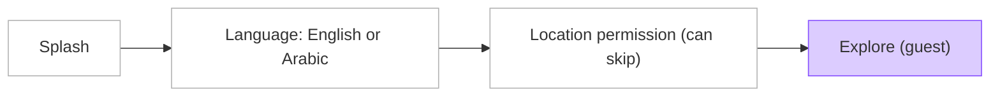

### C2 Sign-in sheet

Opens over the current step; choices are kept.

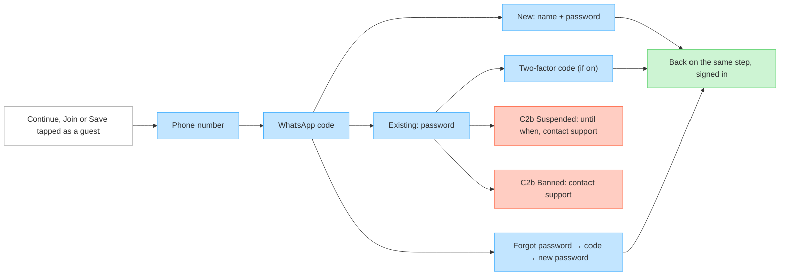

### C3 Explore

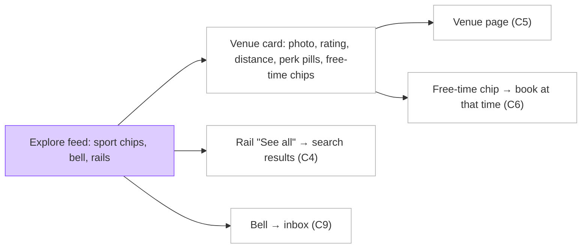

### C4 Search

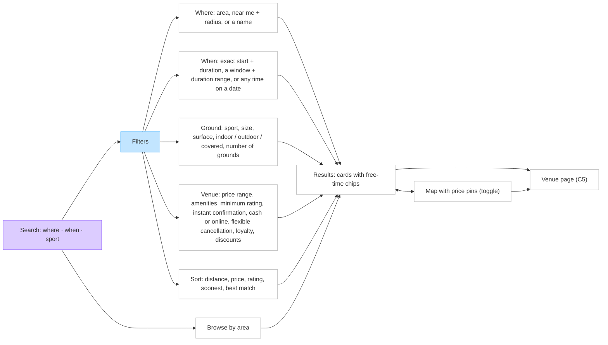

### C5 Venue page

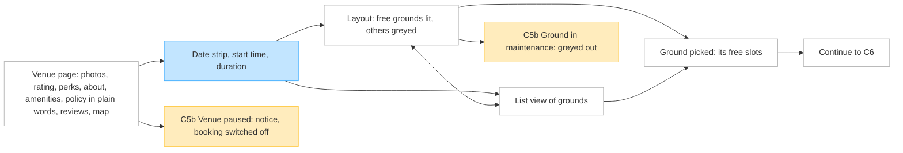

### C6 Book

Short steps, each with a pinned total bar and Continue.

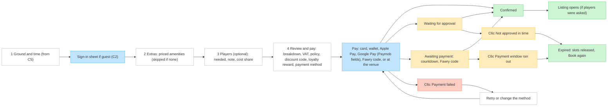

### C6b Fully booked

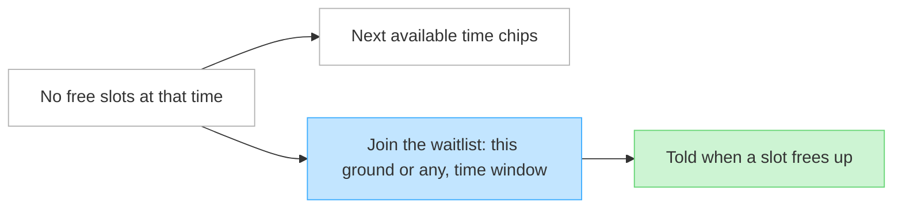

### C7 Bookings

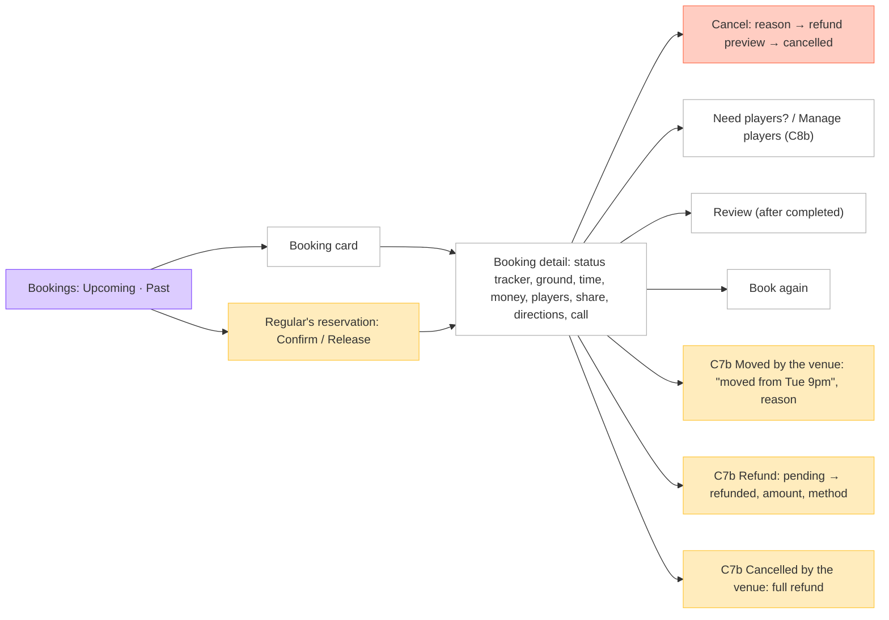

### C8 Games

Open games. The disclaimer is on the listing and the Join button.

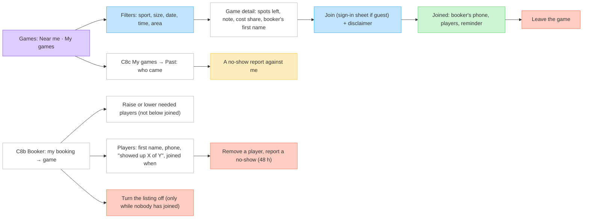

### C9 Inbox

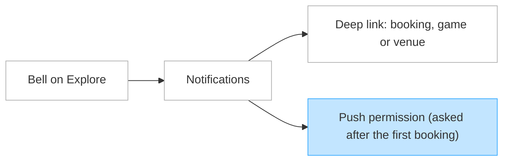

### C10 Account

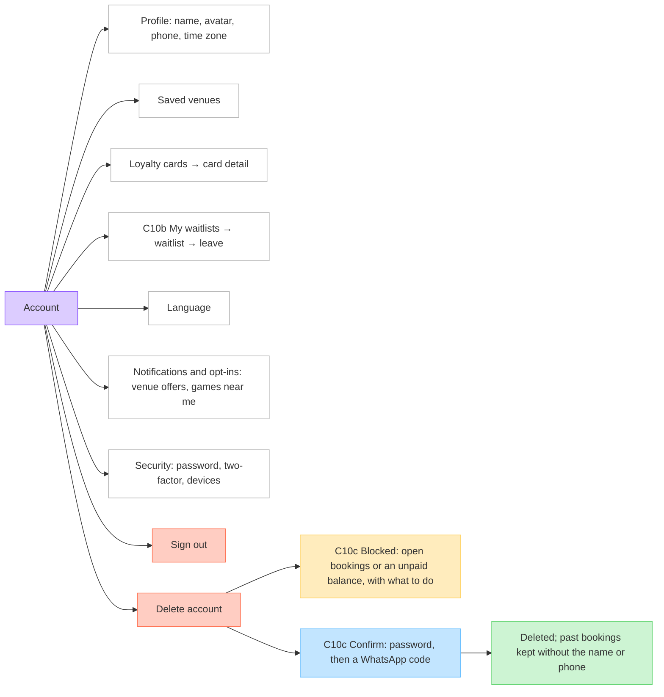

## Dashboard app

Expo, for venue staff. Screens and actions a member has no permission for are hidden (seven areas, each none, view or manage; owners manage everything).

### D1 Auth

Built in PR 1.U1.

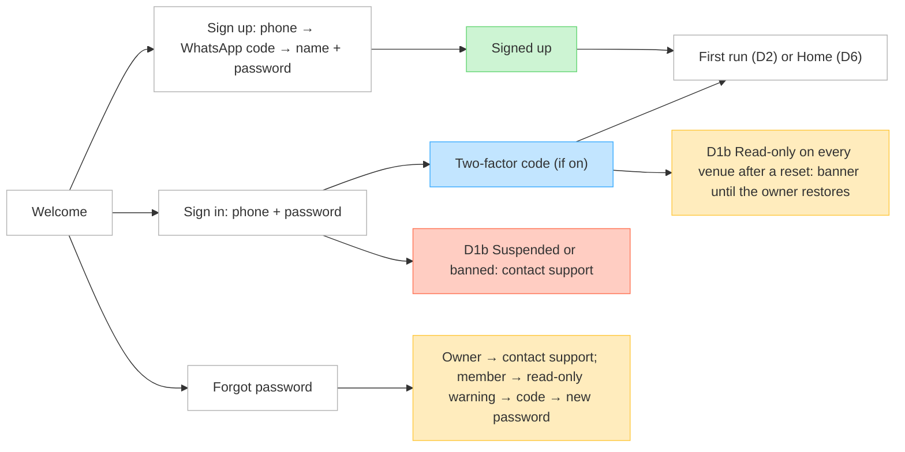

### D2 First run, D3 venue switcher, D4 creating a venue

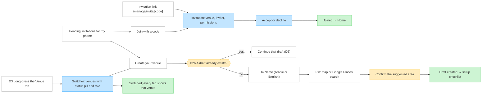

### D5 Setup checklist and review

The checklist is Home while the venue isn't live. Items are done in any order, each saved as real data.

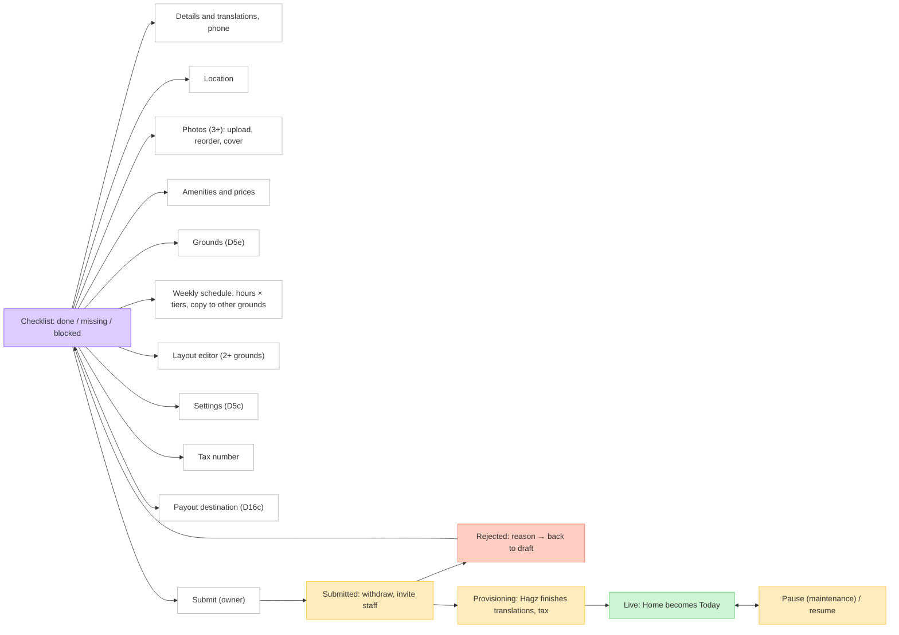

### D5c Settings

Setup → Settings is a grouped list; each group is its own screen. Saving applies at once and shows in Activity.

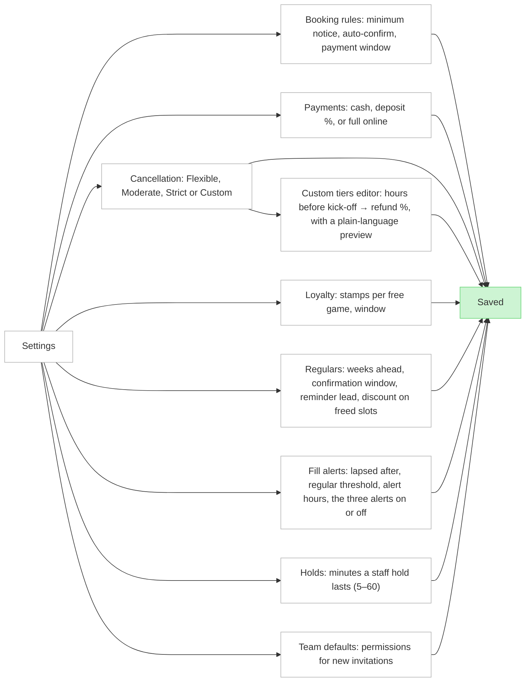

### D5e Grounds

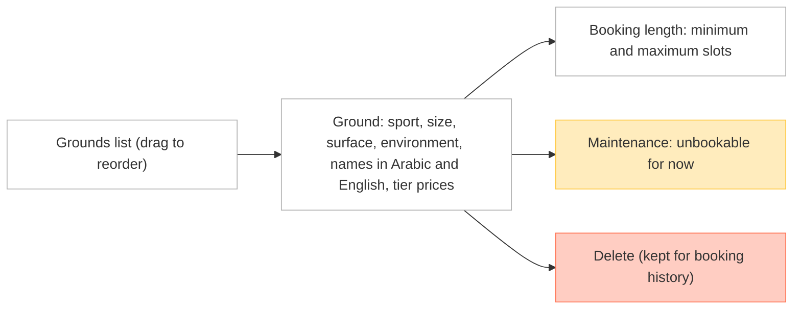

### D6 Home (Today)

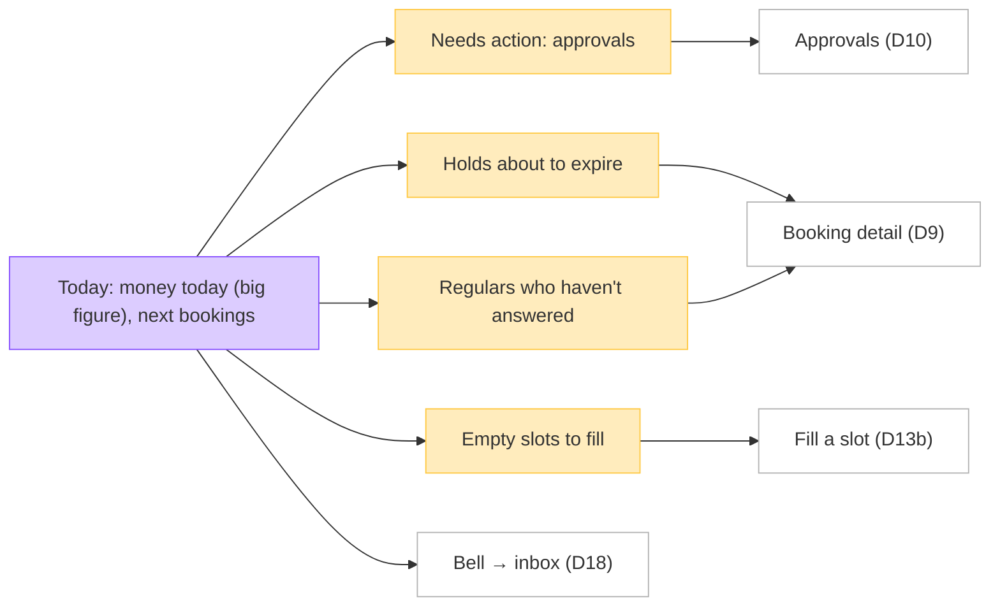

### D7 Calendar

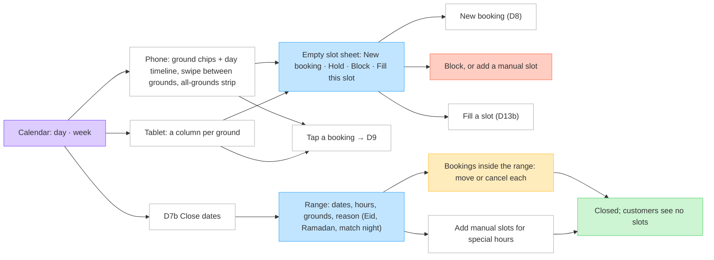

### D8 New booking

Slot first.

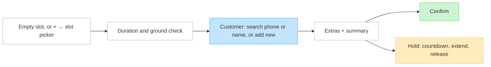

### D9 Booking detail and D10 approvals

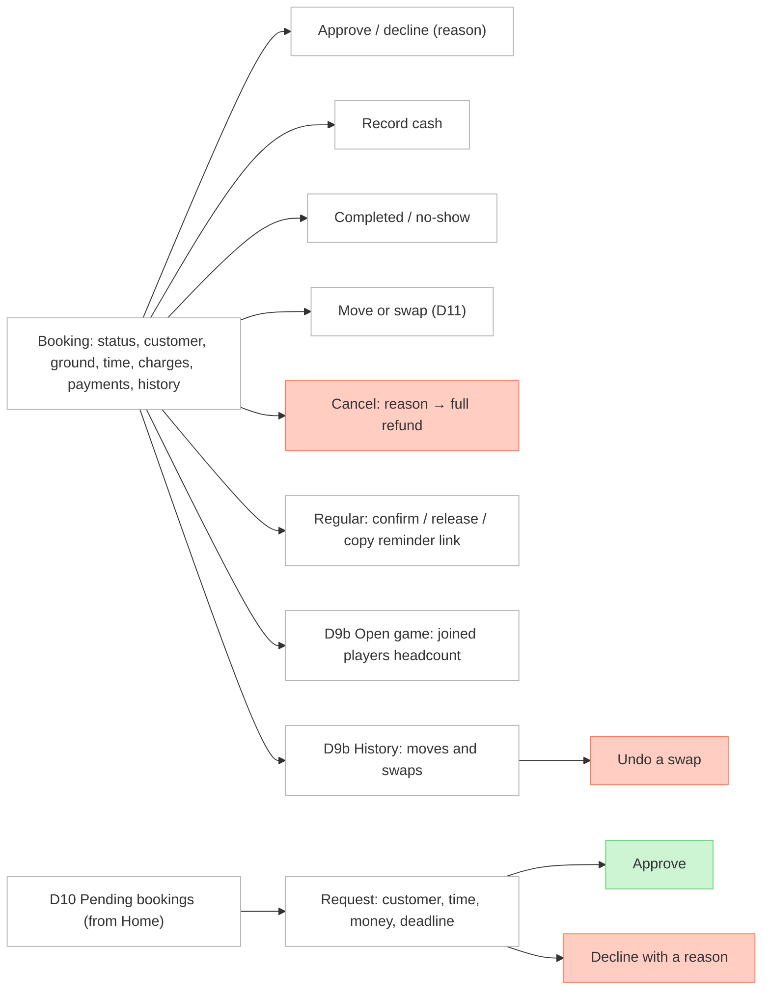

### D11 Move and swap

Pick mode.

```mermaid
flowchart LR
  classDef default fill:#FFFFFF,stroke:#B3B3B3
  classDef sheet fill:#C2E5FF,stroke:#3DADFF
  classDef result fill:#CDF4D3,stroke:#66D575
  move["Move on a booking"] --> pick["Calendar in pick mode: free slots lit"]
  pick --> free["Tap a free slot → held at once"]
  pick --> taken["Tap a booked slot → offer a swap"]
  free & taken --> confirm["Confirm: old → new, price difference, reason"]:::sheet --> done["Moved or swapped; customers and joined players told"]:::result
```

### D12 Venue tab

```mermaid
flowchart LR
  classDef default fill:#FFFFFF,stroke:#B3B3B3
  classDef hub fill:#DCCCFF,stroke:#874FFF
  venue["Venue (grouped list)"]:::hub
  venue --> customers["Customers and regulars (D13)"]
  venue --> team["Team (D14)"]
  venue --> marketing["Marketing (D15)"]
  venue --> setup["Setup: details, photos, grounds and schedules, layout, settings"]
  venue --> status["Status: pause / resume"]
  venue --> activity["Activity (D19)"]
```

### D13 Customers, regulars and filling slots

```mermaid
flowchart LR
  classDef default fill:#FFFFFF,stroke:#B3B3B3
  classDef sheet fill:#C2E5FF,stroke:#3DADFF
  classDef state fill:#FFECBD,stroke:#FFC943
  classDef result fill:#CDF4D3,stroke:#66D575
  list["Customers: search, groups (lapsed, regular, other)"] --> customer["Customer: history, reliability, loyalty, call / WhatsApp"]
  customer --> make["Make regular: ground, weekday, hour, duration, start / end"] --> regular["Regular: weekly reservations, reliability, pause / end"]
  regular --> edit["D13c Edit time or ground"] --> change["New weekday, hour, duration or ground"]:::sheet
  change --> preview["Preview: unconfirmed weeks re-created, confirmed weeks stay, taken weeks skipped"]:::sheet --> saved["Saved; the customer is told the new time once"]:::result
  topup["D13d Top-up finds a week taken or blocked"] --> skipped["Notice: this week was skipped"]:::state
  skipped --> moveOther["Move the other booking, then retry"]
  skipped --> leave["Leave the week skipped"]
  slot["D13b Empty slot or a fill-a-slot alert"] --> candidates["Ranked candidates: lapsed, active (+ another slot), others, with reasons"]
  candidates --> callThem["Call or WhatsApp from own phone"]
  candidates --> offer["Send an offer push (opted-in app users)"]:::sheet
```

### D14 Team

```mermaid
flowchart LR
  classDef default fill:#FFFFFF,stroke:#B3B3B3
  classDef state fill:#FFECBD,stroke:#FFC943
  classDef result fill:#CDF4D3,stroke:#66D575
  members["Members: role, permission summary"]
  members --> member["Member: 7 areas × none / view / manage, presets"] --> saved["Saved"]:::result
  members --> invite["Invite: phone → permissions → preview message"] --> sent["Invitation sent: code + WhatsApp link"]:::result
  members --> pending["Pending invites: resend, revoke"]
  members --> restore["Restore permissions after a reset"]:::state
```

### D15 Marketing

```mermaid
flowchart LR
  classDef default fill:#FFFFFF,stroke:#B3B3B3
  classDef danger fill:#FFCDC2,stroke:#FF7556
  marketing["Marketing"] --> codes["Discount codes"] --> create["Create: percent or amount, uses, expiry"]
  codes --> revoke["Revoke"]:::danger
  marketing --> loyalty["Loyalty: stamps, window"]
  marketing --> reviews["Reviews (read only)"]
```

### D16 Payments

```mermaid
flowchart LR
  classDef default fill:#FFFFFF,stroke:#B3B3B3
  classDef hub fill:#DCCCFF,stroke:#874FFF
  classDef state fill:#FFECBD,stroke:#FFC943
  classDef result fill:#CDF4D3,stroke:#66D575
  tab["Payments: balance, earnings, recovered revenue"]:::hub
  tab --> insights["Earnings insights: by weekday, by ground"]
  tab --> ledger["Ledger → entry detail"]
  tab --> payouts["Payouts → payout detail"]
  tab --> refunds["Refunds"]
  tab --> owed["D16b You owe Hagz EGP X: why, from which bookings"]:::state --> how["How to pay: wire details, or ask for a cash collection"] --> settlements["Settlements recorded by Hagz"]
  tab --> destination["D16c Add destination: bank, wallet or InstaPay"] --> unverified["Unverified: no payouts until Hagz checks it"]:::state --> verified["Verified"]:::result
  tab --> invoices["D16c Invoices: Hagz commission VAT invoices by month"] --> pdf["Invoice: download PDF"]
```

### D17 Account, D18 inbox, D19 activity

```mermaid
flowchart LR
  classDef default fill:#FFFFFF,stroke:#B3B3B3
  classDef hub fill:#DCCCFF,stroke:#874FFF
  classDef sheet fill:#C2E5FF,stroke:#3DADFF
  classDef danger fill:#FFCDC2,stroke:#FF7556
  account["Account"]:::hub --> profile["Profile, language"]
  account --> security["Security: password, two-factor, devices"]
  account --> notifications["Notifications, invitations"]
  account --> del["Delete account"]:::danger
  account --> signout["Sign out"]:::danger
  bell["D18 Bell on Home"] --> inbox["Notifications: approvals, fill alerts, regulars, staff changes, venue review"]
  inbox --> deep["Deep link to the booking, slot, member or checklist"]
  inbox --> push["Push permission (asked after the first sign-in)"]:::sheet
  activity["D19 Venue → Activity"] --> filter["Filter: type, member, dates"]:::sheet --> event["Event: who, what, before → after"]
```

## Public web

Next, server-rendered in `/ar` and `/en`. View only.

```mermaid
flowchart LR
  classDef default fill:#FFFFFF,stroke:#B3B3B3
  classDef state fill:#FFECBD,stroke:#FFC943
  classDef result fill:#CDF4D3,stroke:#66D575
  classDef danger fill:#FFCDC2,stroke:#FF7556
  landing["W1 Landing: what Hagz is, app store badges"] --> areas["Browse areas"] --> area["Area page /eg/cairo/maadi: live venues"]
  landing --> byName["Search venues by name"]
  area & byName --> venue["W2 /venue/[slug]: photos, rating, grounds, amenities, policy, map, reviews"]
  venue --> times["Free times today (read only)"] --> app["Book in the app → opens the app or the store"]:::result
  shared["W3 /b/[code]: venue, ground, time"] --> game["Open game: spots left, Join"]:::state
  shared --> summary["Plain booking summary"]
  game & summary --> getApp["Opens the app, or #quot;Get the app#quot;"]:::result
  reminder["W4 Regular's reminder link (no sign-in)"] --> reservation["Reservation: ground, time, deadline"]
  reservation --> confirmed["Confirmed"]:::result
  reservation --> released["Released"]:::danger
  reservation --> stale["Expired or already answered"]:::state
  invite["W5 /manage/invite/[code]"] --> inviter["Venue and inviter"] --> dashboard["Opens the dashboard app, or the store"]:::result
```

## Admin web

Next, English only, desktop. Invite-only admins with email, password and an authenticator app. Every action is recorded.

### A1–A4 Sign-in, admins and venues

```mermaid
flowchart LR
  classDef default fill:#FFFFFF,stroke:#B3B3B3
  classDef hub fill:#DCCCFF,stroke:#874FFF
  classDef sheet fill:#C2E5FF,stroke:#3DADFF
  classDef result fill:#CDF4D3,stroke:#66D575
  classDef danger fill:#FFCDC2,stroke:#FF7556
  signin["A1 Email + password"] --> setup["Authenticator setup: QR, first code"]:::sheet
  signin --> code["Authenticator code"]:::sheet
  setup & code --> home["Admin home: queues and counts"]:::hub
  admins["A2 Admins list"] --> inviteAdmin["Invite by email"] --> accept["Accept invitation page"]
  admins --> revoke["Revoke an invitation"]:::danger
  admins --> suspend["Suspend / reset authenticator"]:::danger
  queue["A3 Queue: submitted, oldest first"] --> review["Venue: checklist, owner, submission history"]
  review --> reject["Reject with a reason"]:::danger
  review --> approve["Approve → provisioning"] --> provision["Provision: translations, tax number, commission override, photos"] --> live["Go live"]:::result
  venues["A4 Venues in any status: search"] --> venue["Venue detail"]
  venue --> pause["Pause / resume"]
  venue --> history["History: each change, with revert"]
  venue --> transfer["Transfer ownership"]
```

### A5–A8 Reference data, support, money and moderation

```mermaid
flowchart LR
  classDef default fill:#FFFFFF,stroke:#B3B3B3
  classDef state fill:#FFECBD,stroke:#FFC943
  classDef sheet fill:#C2E5FF,stroke:#3DADFF
  classDef result fill:#CDF4D3,stroke:#66D575
  classDef danger fill:#FFCDC2,stroke:#FF7556
  reference["A5 Reference data"] --> markets["Marketplaces: currency, VAT, commission"]
  reference --> locations["Locations tree, with translations"]
  reference --> amenityOptions["Amenity options, with translations"]
  people["A6 Customers and staff: search by phone"] --> person["Account: sessions, memberships, bookings"]
  person --> suspend["Suspend / reactivate"]:::danger
  person --> ownerReset["Reset an owner's password (after an identity check)"]
  lookups["A7 Lookups"] --> bookings["Bookings + their events"] --> anyRefund["Cancel with any refund"]:::danger
  lookups --> payments["Payments: resolve stuck ones"]
  lookups --> runs["Payout runs"] --> payout["Payout detail"]
  lookups --> adjust["Ledger adjustments (with a note)"]
  owed["A7b Negative balances: venues by amount owed"] --> ledger["Venue ledger"] --> settle["Record settlement: amount, wire or cash, reference (an ADJUSTMENT)"]:::sheet --> updated["Balance updated; the venue sees it"]:::result
  destinations["A7c Destinations awaiting a check"] --> destination["Destination: holder, bank, account number"]
  destination --> verify["Verify (payouts can start)"]:::result
  destination --> invalid["Not valid: tell the venue to add another"]:::danger
  audit["A7d Nightly audit"] --> drift["Drift alerts: ledger vs payments, refunds, payouts"]:::state --> affected["Alert detail: affected entries"]
  moderation["A8 Moderation"] --> hide["Reviews: hide"]
  moderation --> reports["Game no-show reports: remove unfair ones"]
  moderation --> logs["Notification delivery logs"]
```
